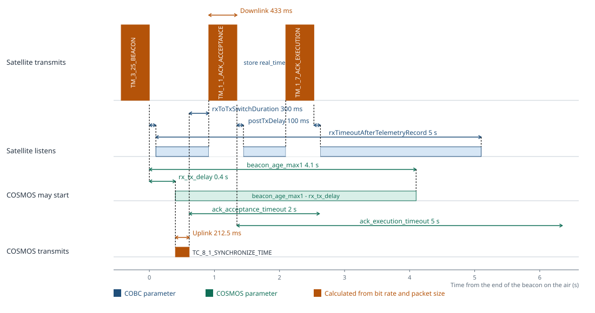

# Command at the earliest instant COSMOS allows

A command that is ready when the beacon arrives waits out `rx_tx_delay`, then the uplink, the satellite's 300 ms pad, and both verification frames. At 9600 bit/s both frames come back inside the installed acceptance and execution timeouts.

| Color | What it marks |
| --- | --- |
| Blue | COBC parameter: `postTxDelay` 100 ms, `rxToTxSwitchDuration` 300 ms, `rxTimeoutAfterTelemetryRecord` 5 s |
| Green | COSMOS parameter: `rx_tx_delay` 0.4 s, `beacon_age_max1` 4.1 s, `ack_acceptance_timeout` 2 s, `ack_execution_timeout` 5 s |
| Amber | Calculated airtime at 9600 bit/s. Uplink is 255 bytes, 212.5 ms. Beacon, acceptance, and completion are each one 520-byte downlink frame, 433 ms |

Both directions use 9600 bit/s. The downlink frame is longer, and takes longer, because it has convolutional coding and the uplink frame does not.

Time zero is the end of the beacon on the air. Propagation is ignored, so that instant is the same at the satellite and at the ground. COSMOS may start any time until `beacon_age_max1`, 4.1 s. This case starts at `rx_tx_delay`, 0.4 s.

Acceptance arrives about 0.73 s after the end of the uplink. The execution timeout starts when that acceptance frame ends.

The command is `TC_8_1_SYNCHRONIZE_TIME`. The beacon is `TM_3_25_BEACON`. The satellite sends `TM_1_1_ACK_ACCEPTANCE`, stores the new `real_time`, and sends `TM_1_7_ACK_EXECUTION`. The store is one persistent-variable write.

Source: `RfRxTxTiming.md` at 9600 bit/s, and the installed values in `openc3-cosmos-sts1-gs/plugin.txt` and `openc3-cosmos-sts1-ops/plugin.txt`.
